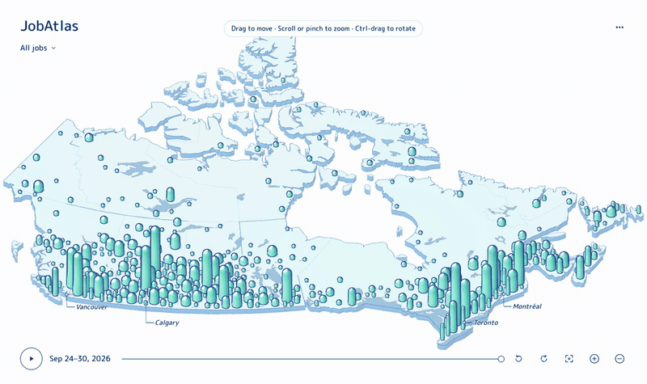

# JobAtlas

A map of where Canada is hiring. It shows new job postings by city and occupation, day by
day, from January 2023 to now.

**[jobatlas-eight.vercel.app](https://jobatlas-eight.vercel.app)**



I started this while looking for a software job in Toronto. I wanted to see where postings
actually were and how that changed week to week. The federal Job Bank publishes every
posting as open data, about 3.8 million since 2023, but it carries few tech roles: around
360 software developer postings nationwide in September 2026. So I'm adding a second
dataset, Employer boards, collected daily from companies' public Greenhouse, Lever and
Ashby job boards. Both use the same counting rules but stay separate, since they cover
different employers and adding them up would double-count.

## How it works

Job Bank releases one file per month. A daily job checks for new or changed files and
imports them. Imports can be re-run safely: postings are deduplicated by their Job Bank ID,
or by a row fingerprint for the 2024 months that were published without IDs.

Each posting is matched to a GeoNames place (97% match). Old amalgamated municipalities
fold into their city, so North York counts as Toronto. Occupation comes from the NOC 2021
code, with English and French title rules as a fallback. Anything ambiguous stays
unclassified.

Counts are computed per Toronto calendar day and published as a versioned release that
goes live in one transaction. When a month changes, only that month is recomputed, and a
test checks the result against a full rebuild.

The map distinguishes zero from unknown. A city with no postings gets a flat base; a gap
in the data gets a dashed ring. If the real data can't be loaded, the API returns an error
rather than falling back to demo data.

```text
Job Bank (monthly) ──▶ PostgreSQL ──▶ daily metrics ──▶ FastAPI ──▶ React + Three.js
                       (Celery workers, versioned releases)
```

Python, FastAPI, SQLAlchemy, PostgreSQL, Celery, Redis · TypeScript, React, Three.js, Vite ·
GitHub Actions, Vercel, AWS (Docker Compose, Caddy)

## Running locally

```sh
cp .env.example .env
docker compose -f infra/compose.yaml up -d --build
docker compose -f infra/compose.yaml exec worker jobatlas atlas-cities
docker compose -f infra/compose.yaml exec worker jobatlas atlas-groups   # metro groups
docker compose -f infra/compose.yaml exec worker jobatlas atlas-sync   # ~30 min, ~2 GB
```

The web app runs at localhost:5173 and the API docs at localhost:8010/api/v2/openapi.json.
Tests: `uv run pytest` in `backend/`, `npm test` and `npm run e2e` in `apps/web/`.

Metric definitions are in [docs/atlas-v2.md](docs/atlas-v2.md) and deployment notes in
[docs/DEPLOY.md](docs/DEPLOY.md).

## Data

Job Bank data is used under the
[Open Government Licence – Canada](https://open.canada.ca/data/en/dataset/ea639e28-c0fc-48bf-b5dd-b8899bd43072).
City locations are from [GeoNames](https://www.geonames.org/) (CC BY 4.0) and outlines from
[Natural Earth](https://www.naturalearthdata.com/) (public domain). This is a personal
project, not a Government of Canada product.
